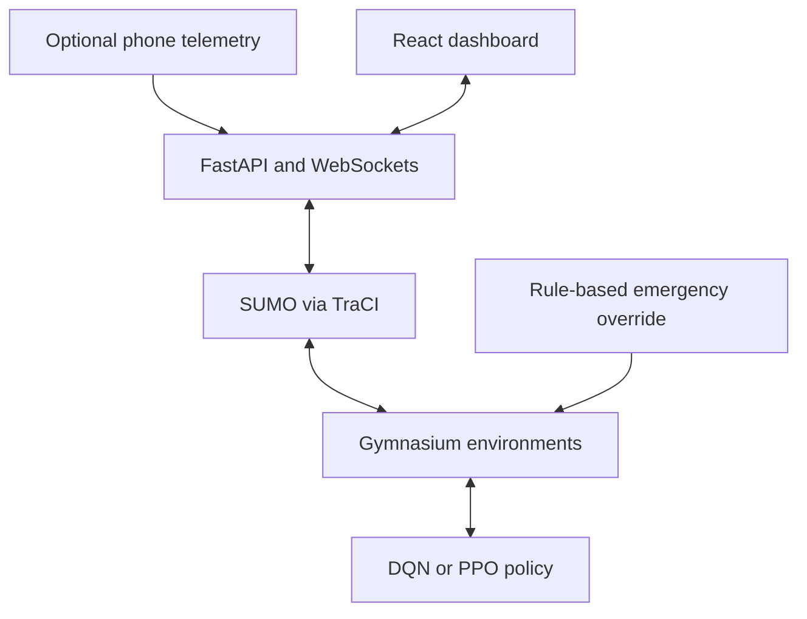

# Traffic RL Twin
### A local traffic-simulation and reinforcement-learning workbench

Traffic RL Twin connects a **SUMO/TraCI simulation** to a FastAPI/WebSocket backend and React dashboard. It is a prototype for exploring signal control, vehicle telemetry and emergency preemption—not a deployed city traffic controller.

**Python · SUMO · Gymnasium · Stable-Baselines3 · FastAPI · React/Vite**

[Simulation code](simulation/) · [Agent implementations](agents/) · [Training configuration](training/config.yaml) · [Dashboard](frontend/src/)

**Demo status:** local setup only; no verified hosted service or usable demo recording is available. The tracked `docs/demo.gif`, `docs/architecture.png` and `docs/report.pdf` are empty placeholders and are not evidence.

## What is implemented

- SUMO environment wrappers, vehicle state and reward functions.
- DQN traffic-control and PPO emergency training/loading code using Stable-Baselines3.
- Emergency control with a **rule-based default mode** and an optional learned-policy path. A green corridor demonstration alone is not proof that PPO is running.
- FastAPI simulation/agent/metrics routes, WebSocket broadcasts, map/vehicle controls and a React visualization.
- An Expo mobile-client path for GPS/accelerometer telemetry and coordinate mapping. It is a simulation interface, not validated road deployment.



## Run locally

Use Python **3.10 or 3.11** for the older pinned Python stack, plus Node.js **18+** and npm. Install SUMO, ensure `sumo --version` works and set `SUMO_HOME` to its installation when needed. GPU acceleration is optional. Source paths and SUMO configuration files are local to this clone.

```bash
git clone https://github.com/krishmannadal/traffic-rl-twin.git
cd traffic-rl-twin
python -m venv .venv
source .venv/bin/activate
# Windows PowerShell: .\.venv\Scripts\Activate.ps1
python -m pip install -r requirements.txt
cd frontend
npm ci
cd ..
python start_demo.py
```

The launcher starts FastAPI on port **8000** and Vite on **5173**. Open `http://localhost:5173`; API documentation is at `http://localhost:8000/docs`. Select a map and start simulation before expecting live vehicles/metrics. A missing trained checkpoint does not become a trained policy merely because the dashboard renders.

For separate terminals:

```bash
python -m uvicorn api.main:app --host 127.0.0.1 --port 8000
# In another terminal, from frontend/:
npm run dev
```

The frontend contains hard-coded localhost HTTP/WebSocket URLs. Remote hosting requires configuration work; the current README does not claim a ready cloud deployment. `SUMO_HOME` is the main environment setting; training parameters and optional W&B logging are in `training/config.yaml`. W&B authentication is needed only if enabled tracking is used.

## Example workflow

1. Start the API and dashboard, choose a bundled simulation/map and start it.
2. Inspect queue/wait telemetry and inject a vehicle using the dashboard controls.
3. Trigger an emergency and inspect the rule-based override.
4. Train/load a policy separately, then compare it against a fixed-timer and random baseline using matched routes, demand and seeds.

This describes a source-supported workflow, not a newly recorded successful SUMO run.

<details>
<summary>Training, evaluation and optional phone client</summary>

Run from the repository root after installing the simulator:

```bash
python -m training.train_traffic
python -m training.train_emergency
python -m training.evaluate --agent traffic --episodes 10
```

The default evaluation checkpoint is `models/saved/traffic_dqn_final.zip`; the emergency path expects `emergency_ppo_final.zip`. These files are not shipped as trained results. Evaluation writes `docs/eval_results_traffic.json` or its emergency equivalent.

**Evaluation caveat:** `training/evaluate.py` currently constructs `EmergencyEnv` for both agent selections. Check observation/action compatibility before using its traffic-agent results. Its `mean_waiting_time` averages **per-episode sums of step-reported waiting time**, not a demonstrated mean delay per vehicle. Define units/denominators before comparing numbers.

The optional Expo client lives in `frontend/mobile/` and has its own package.json. The main launcher does not complete phone setup; configure the backend address and network reachability as described in its source before using a physical device. No physical-phone test was run in this audit.

</details>

## Evidence and current limits

The **frontend production build passed** during the 23 October 2026 documentation audit. SUMO is absent from the audit environment, so backend simulation, training, phone integration and performance were not rerun.

The former README's ~45s / ~32s / ~18.5s comparison has no supporting committed evaluation output in this checkout. It is omitted rather than presented as measured improvement. “Production-grade,” “high-fidelity” and GPU-optimization claims also require evidence beyond the current code.

Next: repair and qualify the evaluator; publish matched-seed baseline runs with metric definitions; attach a real short recording; parameterize frontend endpoints; test end-to-end simulator and emergency-policy behavior.

## Credits and licensing

Repository history records Krishmannadal's implementation commits. SUMO, Stable-Baselines3 and other dependencies retain their own licenses. No repository-level license file is present; the former MIT badge did not establish a license and has been removed. No license is added by this update.
